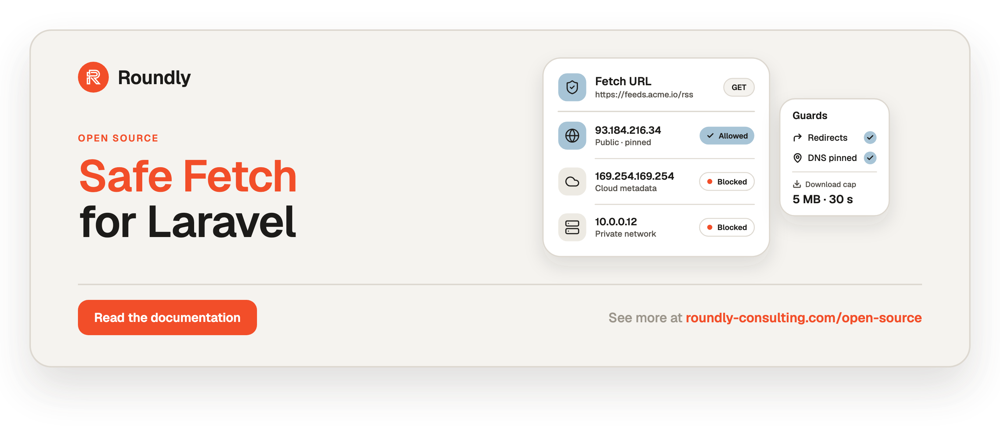

<!-- roundly-hero:start -->
<p align="center">
  <a href="https://roundly-consulting.com/open-source/docs/safe-fetch-for-laravel?utm_source=github&utm_medium=readme&utm_campaign=open-source&utm_content=safe-fetch-for-laravel">
    
  </a>
</p>
<!-- roundly-hero:end -->

<!-- roundly-badges:start -->
<p align="center">
  <a href="https://packagist.org/packages/roundly-consulting/safe-fetch-for-laravel"></a>
  <a href="https://github.com/roundly-consulting/safe-fetch-for-laravel/actions/workflows/run-tests.yml"></a>
  <a href="https://github.com/roundly-consulting/safe-fetch-for-laravel/actions/workflows/fix-php-code-style-issues.yml"></a>
  <a href="https://donate.stripe.com/dRmeVe8FX5PF1Qd9pXcEw00"></a>
  <a href="https://www.patreon.com/cw/roundly"></a>
  <a href="https://roundly-consulting.com/support-us?utm_source=github&utm_medium=readme&utm_campaign=open-source&utm_content=safe-fetch-for-laravel#crypto"></a>
</p>
<!-- roundly-badges:end -->

# Safe Fetch for Laravel

Make server-side requests to URLs you do not control — webhook targets, link previews, avatar,
feed and import URLs — without reaching your own network. Every URL is parsed strictly, every
address it resolves to must be public, and the connection is pinned to exactly those addresses,
redirects included.

## Installation

Requires PHP 8.4 and Laravel 13; `ext-curl` to send requests (`ext-intl` for international
host names).

```bash
composer require roundly-consulting/safe-fetch-for-laravel
```

## Usage

Validate a URL a user hands in, then fetch it — capped, with errors that say whether a retry can
help:

```php
use Illuminate\Support\Facades\Http;
use RoundlyConsulting\SafeFetch\Exceptions\SafeFetchException;
use RoundlyConsulting\SafeFetch\Facades\SafeFetch;
use RoundlyConsulting\SafeFetch\Rules\SafeUrl;

$request->validate(['feed' => ['required', 'string', 'max:2048', new SafeUrl]]);

try {
    $feed = SafeFetch::fetch($request->input('feed'), maxBytes: 2_000_000);
    // $feed->body, $feed->contentType, $feed->url
} catch (SafeFetchException $e) {
    $e->retryable(); // a 5xx or a timeout can heal; a blocked address never does
}
```

Or guard any Laravel HTTP call:

```php
Http::safe()->withToken($token)->post($hookUrl, $payload);
```

<!-- roundly-docs:start -->
## Documentation

The full documentation — configuration, every feature and its API, and testing — lives on our
website: **[roundly-consulting.com/open-source/docs/safe-fetch-for-laravel](https://roundly-consulting.com/open-source/docs/safe-fetch-for-laravel?utm_source=github&utm_medium=readme&utm_campaign=open-source&utm_content=safe-fetch-for-laravel)**

Release notes are in [CHANGELOG.md](CHANGELOG.md). To contribute, see the
[contributing guide](https://github.com/roundly-consulting/.github/blob/main/CONTRIBUTING.md).
<!-- roundly-docs:end -->

<!-- roundly-support:start -->
## Support our work

This package is free and open source, built and maintained by
[Roundly Consulting](https://roundly-consulting.com/open-source?utm_source=github&utm_medium=readme&utm_campaign=open-source&utm_content=safe-fetch-for-laravel).
If it saves you time, please consider supporting our open-source work — a one-time donation, a
monthly pledge on Patreon or a crypto donation helps fund maintenance, new features and new
packages.

<a href="https://donate.stripe.com/dRmeVe8FX5PF1Qd9pXcEw00"></a>
<a href="https://www.patreon.com/cw/roundly"></a>
<a href="https://roundly-consulting.com/support-us?utm_source=github&utm_medium=readme&utm_campaign=open-source&utm_content=safe-fetch-for-laravel#crypto"></a>
<!-- roundly-support:end -->

## License

The MIT License (MIT). See [LICENSE.md](LICENSE.md).
